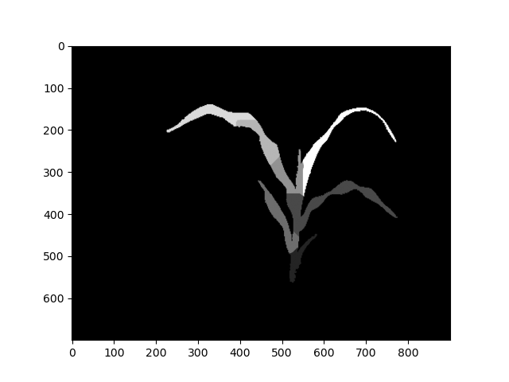

## Analyze morphological traits

Calculates morphological traits and stores them to `pcv.outputs`.

**plantcv.analyze.morphology**(*morph, size=20, stems=False, label=None*)

**returns** Segmented mask, mask with leaves/stems labeled.

- **Parameters:**
    - morph - A [`pcv.morphology.morph`](morphology_class.md) object.
	- size - The size of segment ends to be used in calculating angles and tangents.
	- stems - Logical, should stems be segmented separately (False, the default) or included as their own sections (True).
	- label - Optional label parameter, modifies the variable name of observations recorded. Can be a prefix or list (default = pcv.params.sample_label).

- **Context:**
    - Used to calculate morphological traits. This requires making a `morph` object, which requires a binary mask.

- **Example use:**
    - Below

- **Output data stored:** Data ('segment_path_length', 'segment_insertion_angle', 'segment_area' (or 'leaf_area' and 'stem_area' if `stems = True`), 'mean_segment_width', 'segment_width_std', 'segment_width_max', 'segment_eu_length', 'segment_angle', 'stem_height', 'stem_angle', 'stem_length', 'segment_curvature', 'segment_tangent_angle') are stored to the [`Outputs` class](outputs.md) when this function is run.

```python
from plantcv import plantcv as pcv

morph = pcv.morphology.morph(mask)

leaf_segmented_img = pcv.analyze.morphology(morph)

pcv.outputs.observations["default"]["segment_path_length"]["values"]

```



**Source Code:** [Here](https://github.com/danforthcenter/plantcv/blob/master/plantcv/plantcv/analyze/etr.py)
