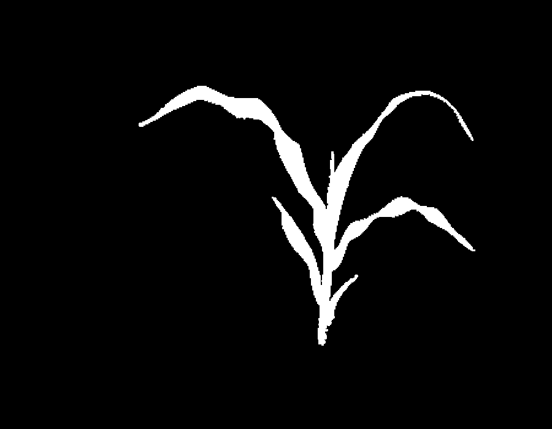
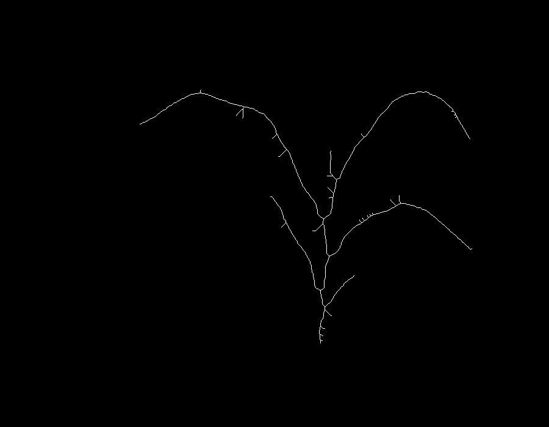
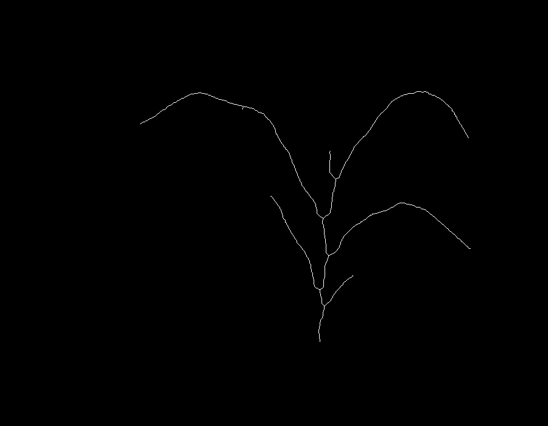

## Morphology Class

Object to store morphology elements including skeletonized mask, stem and leaf contours, and masks/images.

**plantcv.morphology.morph**(*mask, first_stem=True*)

**returns** `morph` class object

- **Parameters:**
    - mask - Binary or Labeled mask of an object.
	- first_stem - Boolean, should the first (bottom) segment always be categorized as a stem? Defaults to True.

- **Attributes:**
    - mask - Input Binary or Labeled mask of an object.
	- skeleton - Single pixel wide skeletonized image of a plant. This is auto-generated from the mask when the class is initialized.
	- stem - list of contours of stem objects, generated automatically from the plant skeleton and updated with pruning.
	- leaves - list of contours of leaf objects, generated automatically from the plant skeleton and updated with pruning.
	- cycles - Numeric, number of cycles in the skeleton. Downstream tools may fail if cycles > 0. If cycles are detected and debug is plot/print then they will be plotted when the attribute is accessed.
	- leaf_tips - list of points representing leaf (and stem) tips.
	- branch_points - list of points representing branch points.

- **Methods**
    - **morph.prune**(*size=0, first_stem=True, reprune=False*)
	  - **size**: size to be pruned off of each branch, branches below this size will be rmoeved.
	  - **first_stem**: Boolean, should the first (bottom) segment always be categorized as a stem? Defaults to True.
	  - **reprune**: Boolean, should the prune be done on the updated, already pruned, skeleton? If False, the default, each prune will start from the original skeleton.
	- **morph.combine_segments**(*leaves=None, stems=None, combined_type=None*)
	  - **leaves**: list of leaf segments to combine (by index)
	  - **stems**: list of stem segments to combine (by index)
	  - **combined_type**: If stems and leaves are combined then is the result a stem or a leaf? Accepts "stem" or "leaf" if leaves and stems are both populated.

- **Context:**
	- Used to generate and store a skeletonized mask from a mask for use with morphology functions. (More pending?)

```python
from plantcv import plantcv as pcv
pcv.params.debug = "plot"
# create a morph object

morpho = pcv.morphology.morph(mask)

# view the skeleton
pcv.plot_image(morpho.skeleton)

# prune the skeleton
morpho.prune(60)

```

**Original Mask:**


**Skeletonized Mask:**


**Pruned Skeletonized Mask:**



**Source Code:** [Here](https://github.com/danforthcenter/plantcv/blob/master/plantcv/plantcv/morphology/morph_class.py)
