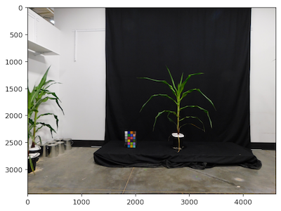
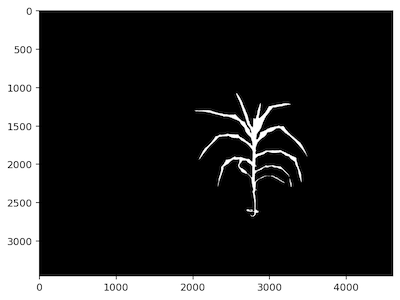
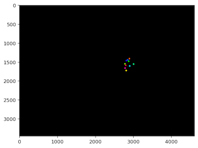

## Sub Mask

Sample circular regions from a mask.

**plantcv.sub_mask**(*img, mask, num_masks=1, radius=5*)

**returns** A `numpy.ndarray` labelled mask.

- **Parameters:**
    - img - Grayscale or RGB image.
    - mask - Binary mask of the image.
    - num_masks - A number of circular regions to make masks of, defaults to 1. These spots cannot overlap, so specifying too many may trigger a warning that fewer masks could be placed than were specified.
    - radius - Radius of the circular region(s) to select. These spots cannot overlap, so specifying too large of a radius may trigger a warning that fewer masks could be placed than were specified.


- **Context:**
    - Used to downsample an image, particularly for spectral analysis.


- **Example use:**
    - Below

```python

from plantcv import plantcv as pcv

img, path, file = pcv.readimage("./maize.png")

mask, path1, file1 = pcv.readimage("./binary_mask.png")

```






```python

spot_masks = pcv.sub_mask(img, mask, num_masks=10, radius=20)

```


**Source Code:** [Here](https://github.com/danforthcenter/plantcv/blob/main/plantcv/plantcv/submask.py)
